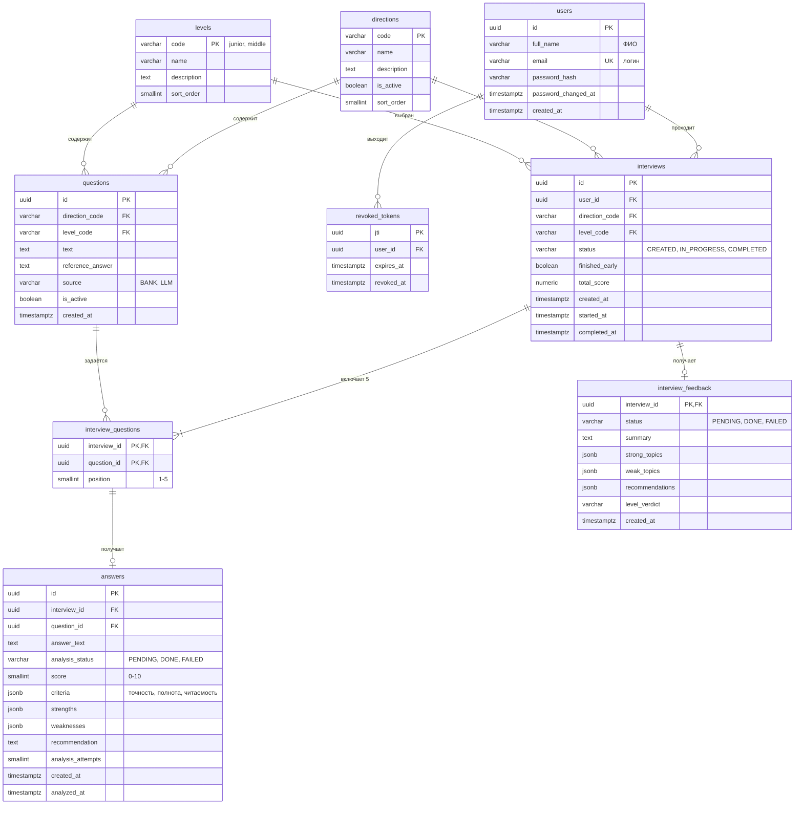

# 8.5. Модель данных

База — PostgreSQL. В основе сущности из документа (User, Interview, Question, Answer); к ним добавлены таблицы, которые нужны для выхода, справочников, порядка вопросов и итоговых рекомендаций. Картинка для Miro — [images/er-diagram.png](images/er-diagram.png).

## Таблицы

| Таблица | Зачем |
| --- | --- |
| `users` | Учётная запись и профиль: ФИО, email, хеш пароля |
| `revoked_tokens` | Токены, отозванные при выходе (UC-007) |
| `directions` | Справочник позиций (IT-направлений). Новая позиция добавляется записью, без изменения кода |
| `levels` | Справочник уровней: Junior, Middle |
| `questions` | База вопросов и вопросы, сгенерированные LLM. `source` показывает происхождение |
| `interviews` | Интервью пользователя |
| `interview_questions` | Какие 5 вопросов входят в интервью и в каком порядке |
| `answers` | Ответы и их разбор от LLM |
| `interview_feedback` | Итоговые рекомендации по интервью (FR-5.7.2) |

## Поля

**users**

| Поле | Тип | Описание |
| --- | --- | --- |
| `id` | uuid, PK | Идентификатор |
| `full_name` | varchar(150) | ФИО, обязательное |
| `email` | varchar(255), unique | Логин, хранится в нижнем регистре |
| `password_hash` | varchar(255) | Хеш пароля (FR-5.1.6) |
| `password_changed_at` | timestamptz | Время последней смены пароля; токены, выданные раньше, недействительны |
| `created_at` | timestamptz | Время регистрации |

**revoked_tokens**

| Поле | Тип | Описание |
| --- | --- | --- |
| `jti` | uuid, PK | Идентификатор отозванного токена |
| `user_id` | uuid, FK → users | Владелец токена |
| `expires_at` | timestamptz | Когда истекает токен; после этого запись можно удалить |
| `revoked_at` | timestamptz | Время выхода |

**directions** — `code` (PK, например `backend_python`), `name`, `description`, `is_active`, `sort_order`.

**levels** — `code` (PK: `junior`, `middle`), `name`, `description`, `sort_order`.

**questions**

| Поле | Тип | Описание |
| --- | --- | --- |
| `id` | uuid, PK | Идентификатор |
| `direction_code` | FK → directions | Позиция |
| `level_code` | FK → levels | Уровень |
| `text` | text | Текст вопроса |
| `reference_answer` | text, nullable | Эталонный ответ для оценки (есть у вопросов из базы) |
| `source` | varchar | `BANK` — из базы, `LLM` — сгенерирован |
| `is_active` | boolean | Используется ли вопрос |
| `created_at` | timestamptz | Время создания |

**interviews**

| Поле | Тип | Описание |
| --- | --- | --- |
| `id` | uuid, PK | Идентификатор |
| `user_id` | FK → users | Владелец |
| `direction_code`, `level_code` | FK | Выбранные позиция и уровень |
| `status` | varchar | `CREATED`, `IN_PROGRESS`, `COMPLETED` |
| `finished_early` | boolean | Завершено досрочно (UC-008) |
| `total_score` | numeric(3,1), nullable | Итоговый балл 0.0–10.0 |
| `created_at`, `started_at`, `completed_at` | timestamptz | Создано, начато, завершено |

**interview_questions** — `interview_id` и `question_id` (составной PK), `position` (1–5, уникальна в рамках интервью).

**answers**

| Поле | Тип | Описание |
| --- | --- | --- |
| `id` | uuid, PK | Идентификатор |
| `interview_id`, `question_id` | FK → interview_questions | Вопрос интервью; пара уникальна — один ответ на вопрос |
| `answer_text` | text | Ответ пользователя |
| `analysis_status` | varchar | `PENDING`, `DONE`, `FAILED` |
| `score` | smallint, nullable | Оценка 0–10 |
| `criteria` | jsonb | Оценки по критериям FR-5.6.2: точность, полнота, читаемость |
| `strengths`, `weaknesses` | jsonb | Сильные и слабые стороны (списки строк) |
| `recommendation` | text | Рекомендация по улучшению ответа |
| `analysis_attempts` | smallint | Сколько раз обращались к LLM |
| `created_at`, `analyzed_at` | timestamptz | Получен ответ, выполнен анализ |

**interview_feedback** — `interview_id` (PK, FK), `status` (`PENDING`, `DONE`, `FAILED`), `summary`, `strong_topics`, `weak_topics`, `recommendations` (jsonb-списки), `level_verdict`, `created_at`.

## Статусы интервью

- `CREATED` → `IN_PROGRESS` — когда пользователь получил первый вопрос.
- `IN_PROGRESS` → `COMPLETED` — когда проанализированы все 5 ответов или пользователь завершил интервью досрочно.

## Удаление профиля

По FR-5.10.3 при удалении пользователя удаляются его данные: внешние ключи от `users` к `interviews` и `revoked_tokens` и далее к `interview_questions`, `answers`, `interview_feedback` — с `ON DELETE CASCADE`. Вопросы в `questions` остаются: они не относятся к пользователю.

## Заметки для Django

- Нужна своя модель пользователя: логин — email, вместо `first_name` и `last_name` — одно поле `full_name`.
- Стандартное хеширование паролей Django (`set_password`) подходит для FR-5.1.6.
- Таблицы и поля можно назвать по правилам Django — важна структура, а не имена.
