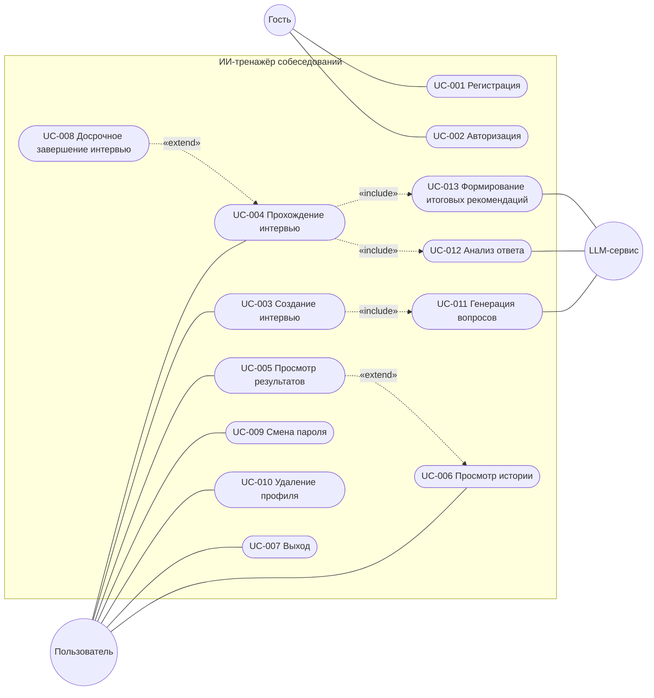

# 7. Пользовательские сценарии (Use Cases)

## 7.1. Акторы системы

| Актор | Тип | Описание |
| --- | --- | --- |
| Гость | Основной, человек | Неавторизованный посетитель: может только зарегистрироваться и войти |
| Пользователь | Основной, человек | Авторизованный студент или начинающий IT-специалист |
| LLM-сервис | Второстепенный, внешняя система | Генерирует вопросы, анализирует ответы и формирует итоговые рекомендации. Вызывается только через backend |

## 7.2. UML Use Case диаграмма

Картинка для Miro — [images/use-case-diagram.png](images/use-case-diagram.png).

Пунктирные стрелки: «include» — шаг выполняется всегда, «extend» — по выбору пользователя.

## 7.3. Реестр Use Cases

| ID | Название | Актор | Связанные ФТ |
| --- | --- | --- | --- |
| UC-001 | Регистрация | Гость | FR-5.1.1 – FR-5.1.7 |
| UC-002 | Авторизация | Гость | FR-5.2.1 – FR-5.2.3 |
| UC-003 | Создание интервью | Пользователь | FR-5.3.1 – FR-5.3.3, FR-5.4.1 – FR-5.4.3 |
| UC-004 | Прохождение интервью | Пользователь | FR-5.5.1 – FR-5.5.4, FR-5.6.1 – FR-5.6.4, FR-5.7.1 – FR-5.7.3 |
| UC-005 | Просмотр результатов | Пользователь | FR-5.8.1 – FR-5.8.3 |
| UC-006 | Просмотр истории | Пользователь | FR-5.9.1 – FR-5.9.3 |
| UC-007 | Выход | Пользователь | FR-5.2.4 |
| UC-008 | Досрочное завершение интервью | Пользователь | FR-5.5.5, FR-5.7.1 |
| UC-009 | Смена пароля | Пользователь | В разделе 5 нет, решение с созвона |
| UC-010 | Удаление профиля | Пользователь | FR-5.10.3 |
| UC-011 | Генерация вопросов | LLM-сервис, включается в UC-003 | FR-5.4.1 – FR-5.4.3 |
| UC-012 | Анализ ответа | LLM-сервис, включается в UC-004 | FR-5.6.1 – FR-5.6.4 |
| UC-013 | Формирование итоговых рекомендаций | LLM-сервис, включается в UC-004 и UC-008 | FR-5.7.2 |

UC-001 – UC-006 совпадают с реестром в документе. UC-007 – UC-010 добавлены по разделу 5 и решениям созвона, UC-011 – UC-013 — шаги, которые выполняет LLM.

## 7.4. Текстовые описания сценариев

### UC-001. Регистрация

- **Актор:** Гость.
- **Цель:** создать учётную запись.
- **Предусловия:** гость не авторизован.
- **Основной сценарий:**
    1. Гость открывает экран регистрации.
    2. Вводит ФИО, email и пароль. Пароль скрыт, его можно показать кнопкой.
    3. Нажимает «Зарегистрироваться».
    4. Система проверяет данные и что email не занят.
    5. Система создаёт учётную запись и профиль.
    6. Система открывает экран входа.
- **Альтернативные сценарии:**
    - 4а. Данные не соответствуют правилам — сообщение у поля, учётная запись не создаётся.
    - 4б. Email занят — сообщение «Пользователь с таким email уже существует».
- **Постусловия:** в системе есть пользователь, пароль хранится в виде хеша.
- **Связанные ФТ:** FR-5.1.1 – FR-5.1.4, FR-5.1.6, FR-5.1.7. **API:** `POST /api/auth/register`.

### UC-002. Авторизация

- **Актор:** Гость.
- **Цель:** войти в систему.
- **Предусловия:** у гостя есть учётная запись.
- **Основной сценарий:**
    1. Гость открывает экран входа.
    2. Вводит email и пароль, нажимает «Войти».
    3. Система проверяет email и пароль.
    4. Система выдаёт токен доступа на 60 минут.
    5. Система открывает главный экран.
- **Альтернативные сценарии:**
    - 3а. Email или пароль неверны — сообщение «Неверный email или пароль»; что именно неверно, не уточняется.
- **Постусловия:** пользователь авторизован.
- **Связанные ФТ:** FR-5.2.1 – FR-5.2.3. **API:** `POST /api/auth/login`.

### UC-003. Создание интервью

- **Актор:** Пользователь.
- **Цель:** выбрать позицию и уровень и начать интервью.
- **Предусловия:** пользователь авторизован.
- **Основной сценарий:**
    1. Пользователь нажимает «Начать интервью» на главном экране.
    2. Система показывает позиции и уровни Junior и Middle.
    3. Пользователь выбирает позицию и уровень и нажимает «Начать».
    4. Система генерирует 5 разных вопросов с помощью LLM на основе базы вопросов (UC-011).
    5. Система создаёт интервью и открывает экран прохождения.
- **Альтернативные сценарии:**
    - 3а. Не выбраны позиция или уровень — кнопка «Начать» неактивна.
    - 4а. LLM недоступна — система берёт 5 вопросов из базы [Предложение]. Если в базе их меньше пяти — сообщение об ошибке, интервью не создаётся.
    - 4б. У пользователя уже есть незавершённое интервью — система предлагает продолжить его ([Вопрос 3](api.md#вопросы-к-команде)).
- **Постусловия:** создано интервью из 5 вопросов, оно привязано к пользователю.
- **Связанные ФТ:** FR-5.3.1 – FR-5.3.3, FR-5.4.1 – FR-5.4.3. **API:** `GET /api/directions`, `POST /api/interviews`.

### UC-004. Прохождение интервью

- **Актор:** Пользователь.
- **Цель:** ответить на вопросы и получить оценку.
- **Предусловия:** интервью создано.
- **Основной сценарий:**
    1. Система показывает текущий вопрос, поле ответа и прогресс «Вопрос N из 5».
    2. Пользователь вводит ответ и нажимает «Отправить».
    3. Система сохраняет ответ, отправляет его на анализ (UC-012) и показывает индикатор загрузки.
    4. Система сохраняет оценку и разбор ответа.
    5. Система показывает следующий вопрос. Шаги 1–5 повторяются до пятого вопроса.
    6. После пятого ответа система завершает интервью: считает средний балл и формирует итоговые рекомендации (UC-013).
    7. Система открывает результаты (UC-005).
- **Альтернативные сценарии:**
    - 2а. Ответ пустой — не отправляется.
    - 2б. Пользователь нажимает «Завершить досрочно» — UC-008.
    - 3а. LLM не ответила — ответ сохранён, система показывает «Не удалось проанализировать ответ» и кнопку «Повторить анализ».
    - *а. Истёк срок действия токена — экран входа; после входа интервью продолжается с текущего вопроса.
- **Постусловия:** интервью завершено, результаты сохранены и привязаны к пользователю.
- **Связанные ФТ:** FR-5.5.1 – FR-5.5.4, FR-5.6.1 – FR-5.6.4, FR-5.7.1 – FR-5.7.3. **API:** `GET /api/interviews/{id}/questions/current`, `POST /api/interviews/{id}/answers`, `POST /api/interviews/{id}/answers/{answerId}/retry`.

### UC-005. Просмотр результатов

- **Актор:** Пользователь.
- **Цель:** узнать итоговый балл и разбор ответов.
- **Предусловия:** интервью завершено.
- **Основной сценарий:**
    1. Система показывает итоговый балл, общий фидбэк и рекомендации.
    2. Пользователь открывает разбор вопроса.
    3. Система показывает текст вопроса, ответ пользователя, оценку и комментарий ИИ.
- **Альтернативные сценарии:**
    - 1а. Итоговые рекомендации не сформированы — разбор ответов виден, на месте рекомендаций кнопка «Повторить».
    - 3а. Интервью завершено досрочно — неотвеченные вопросы помечены «Без ответа».
- **Постусловия:** —
- **Связанные ФТ:** FR-5.8.1 – FR-5.8.3. **API:** `GET /api/interviews/{id}/results`.

### UC-006. Просмотр истории

- **Актор:** Пользователь.
- **Цель:** найти прошлое интервью и вернуться к его результатам.
- **Предусловия:** пользователь авторизован.
- **Основной сценарий:**
    1. Пользователь переходит с главного экрана в личный кабинет и открывает историю.
    2. Система показывает завершённые интервью: дату, позицию, уровень и итоговый балл; новые сверху.
    3. Пользователь выбирает интервью — UC-005.
- **Альтернативные сценарии:**
    - 2а. Интервью нет — сообщение «Вы ещё не проходили интервью» и кнопка «Начать интервью».
- **Постусловия:** —
- **Связанные ФТ:** FR-5.9.1 – FR-5.9.3. **API:** `GET /api/interviews`.

### UC-007. Выход

- **Актор:** Пользователь.
- **Цель:** завершить сессию.
- **Предусловия:** пользователь авторизован.
- **Основной сценарий:**
    1. Пользователь нажимает «Выйти».
    2. Система отзывает токен: он больше не работает.
    3. Система открывает экран входа.
- **Альтернативные сценарии:**
    - 2а. Токен уже недействителен — экран входа всё равно открывается.
- **Постусловия:** токен отозван.
- **Связанные ФТ:** FR-5.2.4. **API:** `POST /api/auth/logout`.

### UC-008. Досрочное завершение интервью

- **Актор:** Пользователь.
- **Цель:** закончить интервью, не отвечая на оставшиеся вопросы, и получить результат.
- **Предусловия:** интервью в процессе, есть хотя бы один ответ.
- **Основной сценарий:**
    1. Пользователь нажимает «Завершить досрочно».
    2. Система просит подтверждения.
    3. Пользователь подтверждает.
    4. Система завершает интервью: средний балл считается по отвеченным вопросам, итоговые рекомендации — по ним же (UC-013).
    5. Система открывает результаты (UC-005).
- **Альтернативные сценарии:**
    - 1а. Ответов ещё нет — [Вопрос 4](api.md#вопросы-к-команде): отменить интервью или не давать завершить.
    - 4а. Какой-то ответ ещё не проанализирован — система предлагает повторить анализ.
- **Постусловия:** интервью завершено и помечено как завершённое досрочно.
- **Связанные ФТ:** FR-5.5.5, FR-5.7.1. **API:** `POST /api/interviews/{id}/complete`.

### UC-009. Смена пароля

- **Актор:** Пользователь.
- **Цель:** заменить пароль.
- **Предусловия:** пользователь авторизован.
- **Основной сценарий:**
    1. Пользователь открывает смену пароля в личном кабинете.
    2. Вводит текущий и новый пароль.
    3. Система проверяет текущий пароль и правила нового (FR-5.1.4).
    4. Система сохраняет новый пароль и завершает сессии на других устройствах.
    5. Система показывает «Пароль изменён»; текущая сессия продолжается.
- **Альтернативные сценарии:**
    - 3а. Текущий пароль неверный — сообщение, пароль не меняется.
    - 3б. Новый пароль не по правилам или совпадает с текущим — сообщение.
- **Постусловия:** войти можно только с новым паролем.
- **Связанные ФТ:** в разделе 5 нет. **API:** `PUT /api/users/me/password`.

### UC-010. Удаление профиля

- **Актор:** Пользователь.
- **Цель:** удалить профиль и все свои данные.
- **Предусловия:** пользователь авторизован.
- **Основной сценарий:**
    1. Пользователь нажимает «Удалить профиль» в личном кабинете.
    2. Система предупреждает, что все интервью и результаты удалятся без возможности восстановления, и просит ввести пароль.
    3. Пользователь вводит пароль и подтверждает.
    4. Система удаляет пользователя, его интервью, ответы и результаты.
    5. Система открывает экран входа.
- **Альтернативные сценарии:**
    - 3а. Пароль неверный — сообщение, ничего не удаляется.
- **Постусловия:** данных пользователя в системе нет, войти под этим email нельзя.
- **Связанные ФТ:** FR-5.10.3. **API:** `DELETE /api/users/me`.
